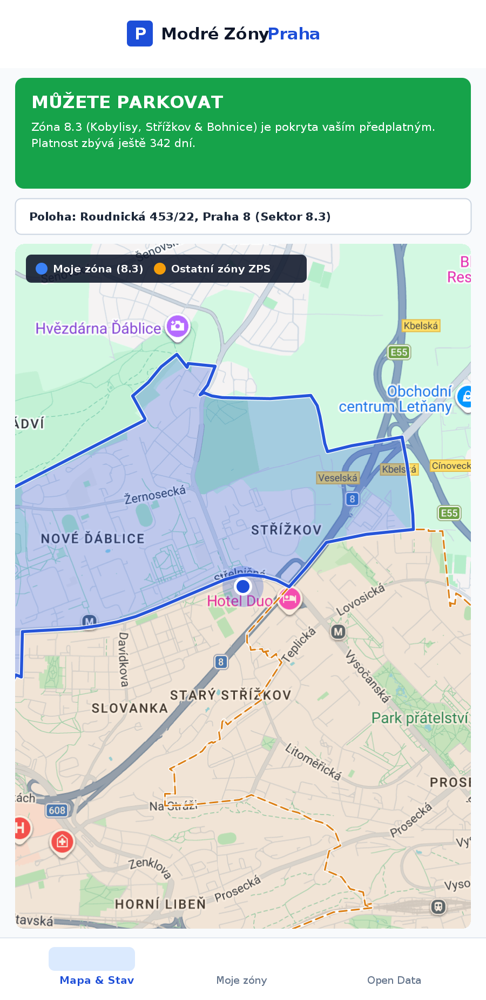
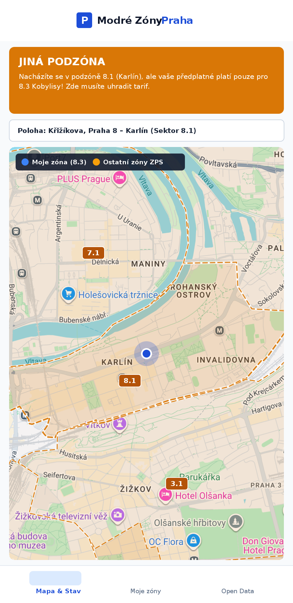
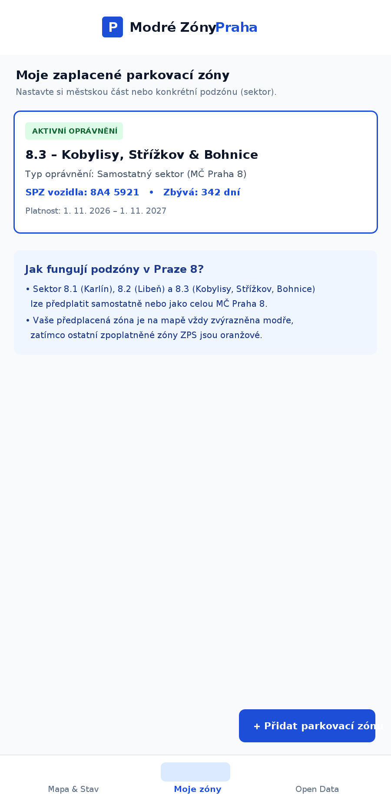
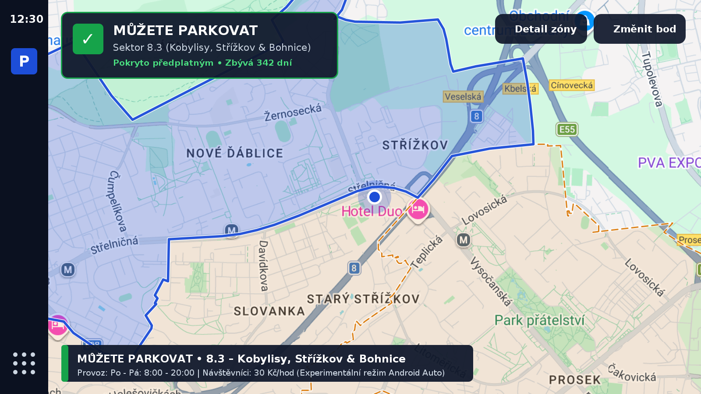

# Modré Zóny Praha (s experimentální podporou Android Auto)


Open-source aplikace pro Android napsaná v **Kotlinu** a **Jetpack Compose**, která řidičům v reálném čase (na telefonu a experimentálně i přímo na palubním displeji vozu v **Android Auto**) ukazuje, zda mohou na aktuálním místě v Praze legálně zaparkovat v rámci svého rezidentního parkovacího oprávnění.

> **Jak projekt vznikl:** Celý tento projekt byl vytvořen v prostředí **Google AI Studio** za využití modelů **Gemini 3.8** a **Gemini 4 Argon** jako ukázkový open-source projekt pro portál **[Dotekomanie.cz](https://dotekomanie.cz)**. Při jakémkoliv dalším použití, úpravách nebo publikaci (včetně Obchodu Google Play) je dle licenčních podmínek (**GNU GPL v3.0 – Sekce 7b**) povinné uvést **Dotekomanie.cz** přímo v nastavení aplikace i v popisu v obchodě s aplikacemi.

---

## Ke stažení (Download APK)

Hotový, zkompilovaný a podepsaný instalační balíček **Modré Zóny Praha** (včetně experimentální podpory pro **Android Auto**) si můžete stáhnout přímo zde bez nutnosti cokoliv kompilovat:

| Soubor ke stažení | Verze | Velikost | Požadavky | Přímý odkaz |
| :--- | :---: | :---: | :---: | :---: |
| **`ModreZonyPraha.apk`** | `1.0` | `24,3 MB` | Android 7.0+ (API 24) & Android Auto (experiment) | **[Stáhnout APK ihned](apk/ModreZonyPraha.apk?raw=1)** |

* **Přímé stažení jedním kliknutím:** Klikněte na **[Stáhnout ModreZonyPraha.apk](apk/ModreZonyPraha.apk?raw=1)** (parametr `?raw=1` na GitHubu rovnou zahájí stahování souboru `.apk`).
* **Umístění v repozitáři:** Soubor najdete také přímo ve složce **[`apk/ModreZonyPraha.apk`](apk/ModreZonyPraha.apk)** nebo v pravém sloupci GitHubu v sekci **[Releases](../../releases)**.
* **Jak APK nainstalovat do telefonu:**
  1. Stáhněte si soubor `ModreZonyPraha.apk` do telefonu s Androidem.
  2. Otevřete stažený soubor (pokud se telefon zeptá, povolte *Instalaci z neznámých zdrojů* pro váš prohlížeč nebo správce souborů).
  3. Pokud chcete vyzkoušet experimentální zobrazení v **Android Auto**, postupujte podle návodu níže v sekci *[Experimentální podpora pro Android Auto](#experimentalni-podpora-pro-android-auto)*.

---

## Ukázkové snímky obrazovky (Screenshots)

| Povolené parkování (Moje zóna 8.3 – modrá) | Upozornění na jinou podzónu (8.1 Karlín – oranžová) | Správa mých parkovacích zón a oprávnění |
| :---: | :---: | :---: |
|  |  |  |

### Ukázka experimentálního rozhraní v Android Auto (Palubní displej vozu)



---

## Hlavní funkce aplikace

* **100% bez nutnosti API klíčů (Keyless Map Engine):**
  * Aplikace kombinuje detailní českou uliční mapu HD a mapový podklad **OpenStreetMap** s automatickou diskovou a paměťovou mezipamětí (`MapTileLoader`).
  * Žádný uživatel si nemusí registrovat účet u Google Cloud ani generovat vlastní API klíč.
* **Přesné katastrální a administrativní hranice zón (Praha 1 až Praha 10):**
  * Obsahuje vícevrcholové polygony pražských zón placeného stání (ZPS) odvozené z oficiálních otevřených dat (`opendata.praha.eu` / OSM hranice městských částí a katastrů).
  * **Podpora sektorů a podzón (např. Praha 8):** Přesně rozlišuje podzóny **8.1 Karlín**, **8.2 Libeň** a **8.3 Kobylisy, Střížkov a Bohnice** (včetně 0% přesahu mezi Prahou 8.3 a Prahou 9). Pokud máte zaplacený pouze sektor `8.3`, aplikace vás při vjezdu do `8.1` nebo `8.2` okamžitě upozorní stavem **„JINÁ PODZÓNA“**.
* **Přehledné barevné odlišení na mapě:**
  * **Modrá zóna (`#1D4ED8`, plná čára):** Zóna nebo podzóna pokrytá vaším aktivním předplatným – zde **můžete parkovat**.
  * **Oranžová zóna (`#D97706`, přerušovaná čára):** Ostatní zpoplatněné modré zóny ZPS, kde vaše předplatné neplatí.
* **Experimentální podpora pro Android Auto (`androidx.car.app`):**
  * Součástí projektu je experimentální modul pro **Android Auto**, který zkouší vlastní vykreslování uliční mapy, polygonů zón, polohy vozu a stavového HUD panelu přímo na displej auta pomocí `CarAppService`, `SurfaceCallback` a `NavigationTemplate`.
  * Detailní obrazovka zóny (`PaneTemplate`) zobrazuje provozní dobu, návštěvnický tarif a stav vašeho oprávnění.
* **Správa parkovacích oprávnění a notifikace:**
  * Ukládání více parkovacích oprávnění (pro celé městské části i jednotlivé sektory) do lokální databáze **Room** a upozornění před vypršením platnosti.

---

## Experimentální podpora pro Android Auto

> **Upozornění:** Podpora pro Android Auto je v této aplikaci zahrnuta jako **technologický experiment**. Google u aplikací instalovaných mimo Obchod Google Play (`sideload`) standardně blokuje navigační a mapové šablony (`CarAppService`), a proto je pro vyzkoušení v autě nutné zapnout vývojářský režim Android Auto.

### Krok 1: Povolení vývojářského režimu v Android Auto
1. V telefonu otevřete **Nastavení → Připojená zařízení → Android Auto**.
2. Sjeďte úplně dolů a **10× rychle poklepejte na položku „Verze“**, čímž odemknete vývojářské nastavení.
3. Vpravo nahoře klepněte na menu (**⋮**) → **Nastavení pro vývojáře**.
4. **Důležité:** Hned první položku **„Režim aplikace“ (Application mode)** přepněte na **„Vývojář“ (Developer)** a dole zaškrtněte **„Neznámé zdroje“ (Unknown sources)**.
5. V nastavení telefonu přejděte do **Aplikace → Android Auto**, klepněte na **Vynutit ukončení** a v sekci **Úložiště** na **Vymazat mezipaměť** (tlačítko pro rychlé otevření najdete přímo v aplikaci na kartě *Nastavení*).

### Krok 2: Spuštění v autě (2 možnosti)
* **Možnost A (Přes „Všechny aplikace pro vozidla“):**
  Po zapnutí vývojářského režimu se v *Přizpůsobit spouštěč* objeví položka **„Všechny aplikace pro vozidla“** (*All car apps*). Nechte ji zaškrtnutou – po klepnutí na ni na displeji auta v ní najdete a spustíte **Modré Zóny Praha**.
* **Možnost B (Samostatná ikona přímo v „Přizpůsobit spouštěč“ na Androidu 14/15):**
  Android 14+ u mapových aplikací kontroluje, zda instalátor nastavil příznak Google Play (`com.android.vending`). Pro zobrazení samostatné ikony nainstalujte `.apk` buď přes bezplatnou utilitu **KingInstaller** přímo v telefonu, nebo z počítače přes ADB:
  ```bash
  adb install -i "com.android.vending" -r app-debug.apk
  ```

---

## Jak nahrát projekt z AI Studia na GitHub a nastavit Social Preview

1. **Nahrání na GitHub přímo z Google AI Studia:**
   * V horní liště nebo v menu nastavení Google AI Studia klikněte na ikonu **GitHub / Export to GitHub** (případně **Download ZIP**).
   * Přihlaste se ke svému GitHub účtu a zvolte název nového repozitáře (např. `modre-zony-praha`).
2. **Nastavení náhledového obrázku repozitáře (GitHub Social Preview – 1280×640 px):**
   * Ve složce `docs/screenshots/` je připravený obrázek přesně v doporučeném rozlišení **1280×640 px** (pod 1 MB):
     * **[`docs/screenshots/social_preview_1280x640.png`](docs/screenshots/social_preview_1280x640.png?raw=1)** (438 KB, PNG)
     * **[`docs/screenshots/social_preview_1280x640.jpg`](docs/screenshots/social_preview_1280x640.jpg?raw=1)** (212 KB, JPG)
   * Na GitHubu otevřete v repozitáři záložku **Settings → General → Social preview**, klikněte na **Edit → Upload an image...** a nahrajte soubor `social_preview_1280x640.png` (nebo `.jpg`).
3. **Automatické sestavení APK na GitHubu (GitHub Actions):**
   * Součástí projektu je připravený workflow soubor `.github/workflows/android-build.yml`.
   * Jakmile kód nahrajete na GitHub, v sekci **Releases** (nebo na záložce **Actions → Artifacts**) najdete automaticky sestavený instalační balíček **`ModreZonyPraha.apk`**.
4. **Lokální sestavení v Android Studiu / příkazové řádce:**
   ```bash
   ./gradlew assembleDebug
   ```
   Výsledný APK soubor najdete v `app/build/outputs/apk/debug/app-debug.apk`.

---

## Struktura projektu

* `apk/ModreZonyPraha.apk` – Zkompilovaný instalační balíček aplikace připravený k přímému stažení.
* `docs/screenshots/` – Náhledový 16:9 obrázek (`hero_preview.jpg`), **GitHub Social Preview 1280×640 px** (`social_preview_1280x640.png` / `.jpg`) a ukázkové snímky obrazovky aplikace i experimentálního režimu Android Auto.
* `app/src/main/java/com/example/`
  * `MainActivity.kt` – Vstupní aktivita aplikace, spodní navigace a správa oprávnění GPS/notifikací.
  * `ui/MainViewModel.kt` – Reaktivní stav aplikace (`StateFlow`), vyhodnocování polohy a správa předplatných.
  * `ui/components/PinchZoomMap.kt` – Interaktivní mapa v Jetpack Compose s vykreslováním dlaždic a polygonů ZPS.
  * `ui/screens/` – Obrazovky *Mapa & Status* (`HomeScreen.kt`), *Moje Zóny* (`SubscriptionsScreen.kt`) a *Nastavení & Android Auto* (`SettingsScreen.kt`).
  * `auto/` – Experimentální modul pro **Android Auto** (`ModreZonyCarAppService.kt`, `ModreZonyCarScreens.kt`, `CarMapSurfaceRenderer.kt`).
  * `data/` – Lokální databáze Room (`AppDatabase.kt`), modely (`ParkingModels.kt`), repozitář (`ParkingRepository.kt`) a přesné hranice pražských zón (`PragueZonesSeed.kt`).
  * `util/` – Sdílený loader mapových dlaždic (`MapTileLoader.kt`), geometrické výpočty ray-casting algoritmem (`GeoMath.kt`), GPS poloha (`LocationHelper.kt`) a notifikace (`NotificationHelper.kt`).

---

## Licence a povinné uvedení zdroje (GNU GPL v3.0 + Sekce 7b)

Tento projekt je licencován pod **GNU General Public License v3.0 (GPL-3.0)** s doplňujícími podmínkami dle **Sekce 7(b)** (viz soubor [LICENSE](LICENSE)):

1. **Povinná atribuce v aplikaci:** Každá kopie nebo upravená verze aplikace musí v obrazovce *Nastavení / O aplikaci* viditelně uvádět **Dotekomanie.cz** s odkazem na `https://dotekomanie.cz`.
2. **Povinná atribuce v obchodech s aplikacemi (Google Play apod.):** Pokud aplikaci nebo její upravenou verzi vydáte v Obchodě Google Play či jiném katalogu, **musíte v popisu aplikace v obchodě viditelně uvést**:
   > *„Založeno na open-source projektu portálu Dotekomanie.cz (https://dotekomanie.cz)“*
